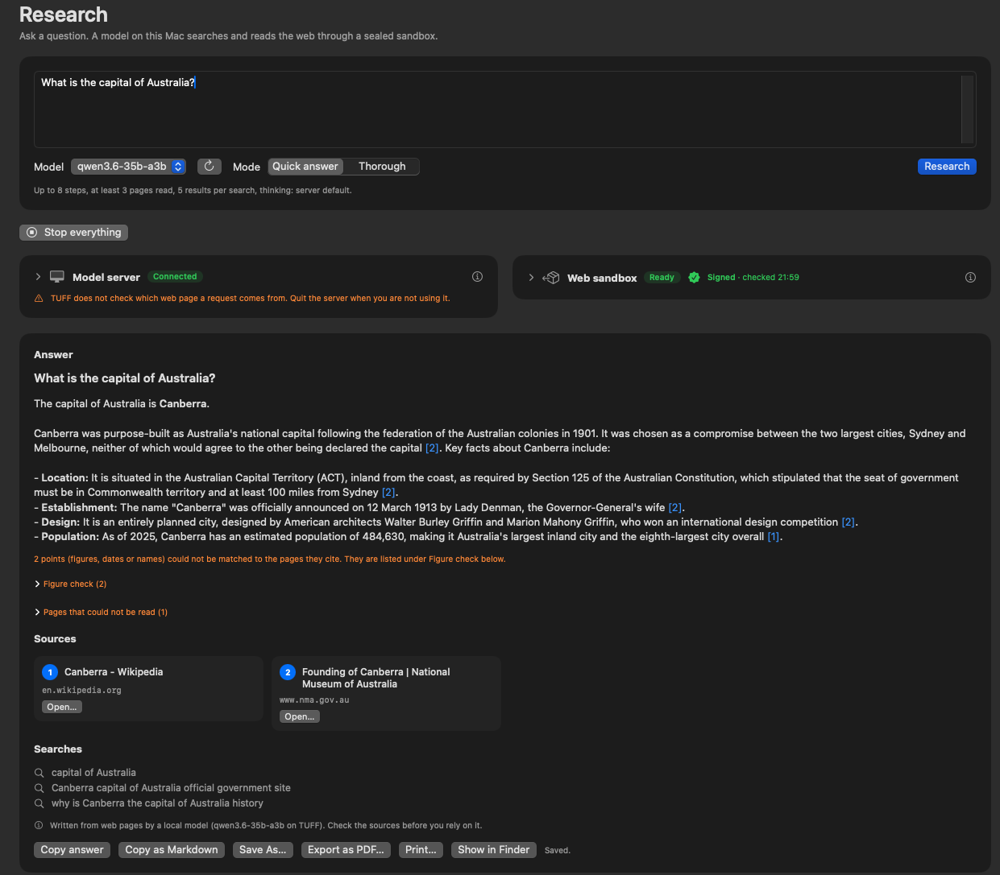
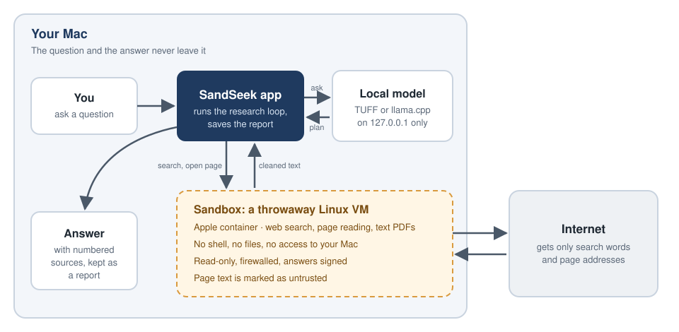

  

<h1 align="center">SandSeek</h1>

SandSeek answers a question by searching the web and reading pages with a
local model, and returns an answer with numbered sources. The model runs on
your Mac. Search and page fetching run inside a disposable Linux VM made by
Apple's [`container`](https://github.com/apple/container) tool. The model has
exactly two tools, `web_search` and `open_page`: no shell, no file access, no
network tool. `open_page` reads web pages and text PDFs (up to 5 MB and 50
pages, no OCR), parsed inside the VM.

Status: 0.1.0, the first release. SandSeek began in a fork of TUFF. The command-line tool,
the core library and the Mac app (a window with the same research loop) are one
Swift package. Built, tested and tried by hand on a Mac with macOS 27, TUFF
8.3.1 and Qwen3.6 35B (11 October 2026); Start server was tried with TUFF 8.3.11
and llama.cpp.

## How it works, in one minute

1. You ask a question in the SandSeek app (or with the `sandseek` command).
2. A model on your own Mac decides what to search for and which pages to read.
3. A throwaway Linux VM does the searching and reading. It turns pages and
   PDFs into plain text and hands back only that text. It cannot reach your
   files, your network or the model.
4. The model writes an answer with numbered sources. SandSeek saves it as a
   report you can reopen later.

Your question and the answer stay on your Mac; only search words and page
addresses go to the internet. More in [docs/HOW_IT_WORKS.md](docs/HOW_IT_WORKS.md).

## Quick start

1. Install [Apple `container`](https://github.com/apple/container) and a local
   model server. SandSeek 0.1.0 works with two:
   - **TUFF** 8.3.1 or newer (tested with Qwen3.6 35B).
   - **llama.cpp** (`llama-server`), experimental in 0.1.0.

   Ollama and LM Studio are planned; other servers are not supported yet.
2. Get the app, in one of two ways:
   - **Download:** `SandSeek-0.1.0.zip` from the release page, unzip it and
     move SandSeek to Applications. It is not notarized: on first launch
     choose System Settings → Privacy & Security → Open Anyway.
   - **Build it yourself:** with Xcode 26 or its command line tools (Swift
     6.2 or newer; 0.1.0 was built on macOS 27):

         git clone https://github.com/Osiriss664/SandSeek.git
         cd SandSeek
         Scripts/package_app.sh

     The app is then `build/SandSeek.app`; move it to Applications. An app
     you built yourself opens without "Open Anyway".
3. Open SandSeek and choose your server on the **Model server** card. Either
   start the server yourself and press **Check**, or choose its program once
   and press **Start server** (TUFF and llama.cpp). Then press **Start
   Sandbox** on the **Web sandbox** card; the first start builds the sandbox
   image and takes a few minutes. Or press **Start everything**, which does
   both and runs the security check. Type your question in the box on top and
   press **Research**. **Stop everything** stops it all again.

Step by step: [docs/INSTALL.md](docs/INSTALL.md).

## Contributions and testing welcome

SandSeek is young, and help is very welcome: code, documentation, ideas, and
above all test reports.

- **Tried it?** Tell us how it went, especially on other Macs (memory, chip,
  macOS version) and with other model servers or models. A short note in the
  [test reports discussion](https://github.com/Osiriss664/SandSeek/discussions/1)
  is enough.
- **Questions and ideas:** [Discussions](https://github.com/Osiriss664/SandSeek/discussions)
  (Q&A and Ideas).
- **Something broken or unclear:** open an [issue](https://github.com/Osiriss664/SandSeek/issues/new/choose);
  the forms ask for the details that help.
- **Want to change code or docs:** see [CONTRIBUTING.md](CONTRIBUTING.md).
- **A security problem:** please report it privately, see [SECURITY.md](SECURITY.md).

## Documentation

- [docs/INSTALL.md](docs/INSTALL.md): requirements, build and package the app,
  start TUFF or llama.cpp safely, first run, where reports live, uninstall.
- [docs/HOW_IT_WORKS.md](docs/HOW_IT_WORKS.md): the research method.
- [docs/SECURITY.md](docs/SECURITY.md): what the sandbox guarantees and what it
  does not, the threat model, the tests and how to run them, known limits.

## Requirements

- Apple silicon, macOS 26 (needed by Apple `container`)
- [Apple `container`](https://github.com/apple/container) 1.5.0 or newer, installed with
  Apple's installer (SandSeek runs only `/usr/local/bin/container`)
- A local model server on 127.0.0.1: TUFF 8.3.1 or newer, or llama.cpp
  (experimental, see below). Streaming is on by
  default for TUFF, so that Stop and the time limits make it stop generating.
  llama.cpp (`llama-server`) is experimental in 0.1.0: it works through
  `--server-type llamacpp` with plain requests (no streaming), the app's
  Thinking switch has no effect on it yet, and it was probed but not measured
  with a research run. The app connects to a
  server that runs on 127.0.0.1, and can also start `TUFFServer` or
  `llama-server` itself (**Start server** on the model server card). It stops
  only a server it started, when you quit it normally.
- A Swift 6.2 toolchain to build

## Build

    swift build -c release

## The app

    Scripts/package_app.sh
    open build/SandSeek.app

The script builds `SandSeekApp` in release mode, assembles `SandSeek.app`
(bundle id `io.github.osiriss664.sandseek`, version 0.1.0, macOS 26 or newer),
copies the sandbox files into `Contents/Resources/sandbox` and signs the bundle
ad hoc. There is no Sparkle update and no notarization yet. `swift run
SandSeekApp` also opens the window, but a bare executable has no sandbox
files inside it (see below).

The window has a sidebar (Research, Reports, Settings, the last few reports).
The Research screen starts with the question field, a model picker and a Quick
answer / Thorough switch. Below it are a card for the model server and a card
for the sandbox with a Security check; click the arrow by a card's title to
fold it. Both fold on their own once everything is ready, and a card opens
again when it stops being ready. While something is not ready, **Start
everything** starts the model server (if you chose a program for it), then the
sandbox, then runs the security check. Progress and answer come below, side by
side. Stop is visible while a question runs. A saved report opened while a
question runs gets a window of its own. Sources are small cards, **Copy
answer** copies the answer as plain text, and a report can be printed or
exported with **Export as PDF…**. When the sandbox is verified, its card shows
"Signed · checked HH:MM". **Stop everything** stops the question, the sandbox
and a model server SandSeek started.

- **Model server.** Pick TUFF (127.0.0.1:8080) or llama.cpp (127.0.0.1:8081);
  Ollama and LM Studio are listed as "later". The address can be edited but
  must be on this Mac's loopback interface, with a port (not the sandbox's
  9100). A ready server is asked only its status route every ten seconds
  (TUFF `/tuff/v1/status`, llama.cpp `/health`); the model list (`/v1/models`)
  is fetched on Check, when the status changes, and from the reload button
  beside the model picker. The type, address and Check are locked while a
  question runs. For llama.cpp the card identifies the server with `/props`
  (sent with the key: a 401 means the key was refused, a JSON object with
  `default_generation_settings` means llama.cpp, anything else is shown as
  "not llama.cpp") and reads the context window from `n_ctx`. It offers a
  start command with `--api-key-file '<path>'`: SandSeek makes a random key
  once and keeps it in `~/Library/Application Support/SandSeek/State` (file
  0600, folder 0700). The key is sent as a Bearer token and is never on a
  command line, in the clipboard text or in a log. The `sandseek` command has
  `--api-key-file <path>` too. On a Mac with 16 GB, run only one model server
  with a loaded model at a time. If the server gives no context size, Settings
  shows a Prompt budget and the card says so. On Check (not on the ten-second
  look) the card also tries this Mac's own network addresses on the server's
  port with a plain TCP connect. It warns ("Something answers at
  <address>:<port>. Other machines on that network can reach it. ...") if one
  accepts, and says it could not tell if an address neither accepted nor refused
  (for example because macOS Local Network access was denied).
- **Sandbox files.** The app carries `Scripts/research_sandbox.sh` and
  `Sandbox/` in `Contents/Resources/sandbox` and runs the script from there, in
  place: the folder is part of the signed bundle, and neither the script nor
  `container build` writes into it, so no copy in a writable folder is needed.
  The image is rebuilt when a hash of the `Sandbox/` files changes.
  `SANDSEEK_SOURCE_DIR=/path/to/checkout` uses a checkout's files instead, but
  only in debug builds or when the app has no files of its own (`swift run`);
  a release app ignores it. The script always gets
  `SANDSEEK_SANDBOX_PORT=9100`, whatever the environment says. The files are
  put into the bundle by `Scripts/package_app.sh` and not declared as SwiftPM
  resources, because the sandbox script needs them as a plain folder laid out
  like a checkout (it builds the image from `../Sandbox`).
- **Reports.** Saved in `~/Library/Application Support/SandSeek/Reports`
  (JSON and Markdown; the format is unchanged, a report only gains the
  optional `serverKind`). Each time the app starts, it copies the reports
  TUFF's research screen saved in `~/Library/Application Support/TUFF/Research
  Reports` that it has not taken over before (once per report id). The
  originals are only read, never moved or deleted, and a report you delete in
  SandSeek does not come back.
- **Presets.** Quick answer: 8 steps, at least 3 pages, 5 results per search.
  Thorough: 30 steps, at least 6 pages, 8 results per search. Both: 4 tool
  calls per step, 3,000 characters of page text, 2,048 tokens per step (8,192
  when thinking is turned on), step limit 30 minutes, thinking limit 3 minutes,
  auto-open, nudges and rewrite on, and thinking left to the server (no
  setting is sent, like the `sandseek` command; Settings can turn it on or
  off). Settings edits the numbers within the ranges the command accepts, and
  stores only what differs from the defaults. The Thorough values are not
  tested yet; they are measured in step 2c (the mock-up said 10 pages; 6 is
  what the top-up that opens search results can reach).
- **Safety rules** (shown in Settings, not editable): two tools only, a
  firewall in the VM, no root in the sandbox, a check before every question,
  and links open only after you confirm the full address.

## Start the sandbox

The app does this itself. By hand:

    Scripts/research_sandbox.sh build
    Scripts/research_sandbox.sh start
    Scripts/research_sandbox.sh selftest

`build` is needed once. `start` publishes the sandbox on 127.0.0.1:9100.
`selftest` is optional and checks the VM's isolation.

## Run

    .build/release/sandseek --server http://127.0.0.1:8080 "your question"

`sandseek --help` lists all options. Tests: `swift test`, and for the sandbox
server `python3 -m unittest Sandbox/test_server.py`.

Security checks (see [docs/SECURITY.md](docs/SECURITY.md)):

    .build/release/sandseek --check-exposure --server http://127.0.0.1:8081
    python3 Scripts/research_address_check.py
    python3 Scripts/research_injection_check.py --base-url <public URL> --label "TUFF + Qwen"

`--check-exposure` tries this Mac's own network addresses on the model server's
port and the sandbox's port. Exit code 0: every address refused the connection.
3: something answered on the network. 4: the model server does not answer on
this Mac at all. 5: some address neither accepted nor refused, so the result
says nothing. 2: bad arguments. `research_address_check.py` sends 98 tricky addresses straight to the
sandbox and expects each to be refused. `research_injection_check.py` takes
`--server-type llamacpp --api-key-file <path>` for llama-server, and `--label`
and `--output` for a report that names the server type and model.

The command finds out which kind of model server it talks to before the sandbox
check: a model server that does not answer ends the run with exit code 1 (as
before), a server that is not recognised as TUFF with exit code 2 (use
`--server-type llamacpp` for llama-server; `research_question_set.py run` and
`research_injection_check.py` pass the option on).

To record real streams from a running server for test fixtures, use
`Scripts/record_stream.py` with the example requests in
`Tests/Fixtures/requests/` (loopback only).

## Left undone

- llama.cpp is experimental: plain (non-streaming) requests, and the
  thinking setting is sent where llama.cpp ignores it (it reads only
  `chat_template_kwargs.enable_thinking`). The probe on a Mac confirmed the
  key file, `/props`, `/health`, tool calls and the context window. Ollama and
  LM Studio come later.
- Thorough preset values are a first guess; they will be adjusted after
  measuring.
- The pre-question check does not yet verify mounts or that port 9100 is
  published by `sandseek-sandbox`.
- Model names in the picker are the ids the server lists; there is no table of
  display names.
- The Quick answer / Thorough switch is labelled in English like the rest of
  the window.
- No app icon, no Sparkle updates, no notarization.

## Security in short

- The VM has a read-only root filesystem, no Mac folders (only a read-only
  folder with its secret), a firewall that
  refuses the Mac, the local network and cloud metadata addresses, and a
  server running as an unprivileged user with no Linux capabilities.
- Fetches are limited to public addresses on ports 80 and 443; every DNS
  answer and redirect is checked again.
- Page text reaches the model wrapped in markers it is told to treat as
  information only; terminal escape codes and invisible Unicode are removed.
- Both services stay on loopback; the sandbox refuses foreign `Host` headers.
  Every request to the sandbox is signed with a secret kept in a file only
  your Mac user can read (so any program running as you can read it, and root
  inside the VM can read the mounted file), a repeated request is refused, and the sandbox does not start without
  its secret.
- Prompt-injection test pages are in `Sandbox/fixtures/injection`
  (`Scripts/research_injection_check.py`). A pass is evidence, not proof.
- TUFF 8.3.1 and llama.cpp have no `Host` check; llama.cpp is used only with
  `--host 127.0.0.1` and `--api-key-file`. `sandseek --check-exposure` and the
  connection card tell you if a server is reachable from the network. The full
  picture is in [docs/SECURITY.md](docs/SECURITY.md).
- A model can still be misled by false content on a page, and search queries
  go to the search engine like any web search. Check the sources.

## Licence

Apache License 2.0, see `LICENSE`. SandSeek began in a fork of TUFF; see
`NOTICE` and `Sandbox/fixtures/injection/THIRD_PARTY_NOTICES.md`.
